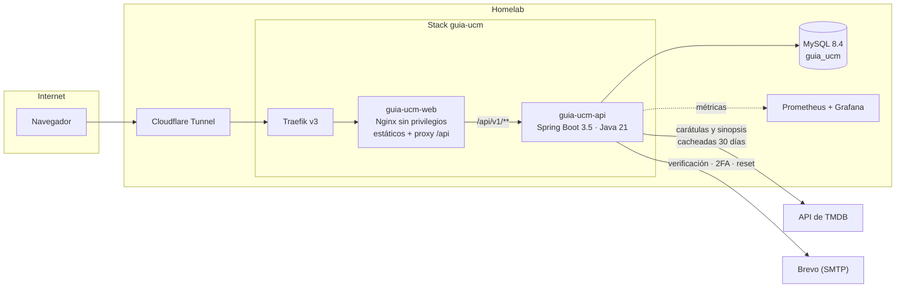

<div align="center">

# Guía UCM

**El Universo Cinematográfico de Marvel en orden cronológico, con tu progreso guardado.**

70 títulos entre películas, series, cortos, especiales y animación, colocados como ocurren en la
historia y no como se estrenaron. Marcas lo que ya has visto, la guía lleva la cuenta y te dice
cuánto te queda y en cuántos días lo terminas.

[](https://github.com/ruubeenn13/guia-ucm/actions/workflows/ci.yml)
[](LICENSE)
[](backend/)
[](frontend/)

</div>

---

> **Estado**: hito 1 (núcleo) terminado. Catálogo, tracker en modo invitado, temas claro/oscuro,
> buscador, filtros, conmutador de orden, estadísticas y calculadora de maratón. Las cuentas
> (hito 2) y las carátulas de TMDB, el multiidioma y el tutorial (hito 3) están en camino; ver
> [Hoja de ruta](#hoja-de-ruta).

## Tabla de contenidos

- [Qué hace](#qué-hace)
- [Capturas](#capturas)
- [Stack](#stack)
- [Arquitectura](#arquitectura)
- [Arranque rápido](#arranque-rápido)
- [Variables de entorno](#variables-de-entorno)
- [Base de datos](#base-de-datos)
- [Endpoints](#endpoints)
- [Tests y calidad](#tests-y-calidad)
- [Despliegue en el homelab](#despliegue-en-el-homelab)
- [Correo transaccional](#correo-transaccional)
- [Seguridad y privacidad](#seguridad-y-privacidad)
- [Licencias de las dependencias](#licencias-de-las-dependencias)
- [Hoja de ruta](#hoja-de-ruta)
- [Documentación](#documentación)
- [Licencia](#licencia)

## Qué hace

- **Orden cronológico de verdad.** Dos sagas, doce bloques temáticos y 70 filas ordenadas por
  cuándo ocurren, con conmutador para verlo por fecha de estreno.
- **Tracker sin cuenta.** Marcas un título y se guarda en el navegador. Nada de registro
  obligatorio para empezar.
- **Cuánto te queda de verdad.** Duración de cada título, tiempo visto, tiempo restante y una
  calculadora de maratón: *«a 2 h al día terminas en 3 meses y 2 días»*.
- **Siguiente para ver.** Un banner con el primer pendiente en orden cronológico, para no tener
  que buscarlo.
- **Buscador que perdona.** Escribir «capitan america» encuentra «Capitán América».
- **Filtros** por tipo de contenido y por estado (todas / vistas / pendientes).
- **Tema claro y oscuro**, con la preferencia del sistema como punto de partida y sin fogonazo
  blanco al cargar.
- **De 320 px a 4K.** Rejilla fluida, tipografía con `clamp()`, áreas táctiles de 44 px y respeto
  por `prefers-reduced-motion`.

## Capturas

<!-- TODO: sustituir por capturas reales cuando estén las carátulas de TMDB (hito 3). -->

| Portada (oscuro) | Guía (claro) | Móvil |
| ---------------- | ------------ | ----- |
| _pendiente_      | _pendiente_  | _pendiente_ |

## Stack

| Capa            | Tecnología                                                          |
| --------------- | ------------------------------------------------------------------- |
| Frontend        | React 19 · Vite 8 · TypeScript estricto · Tailwind CSS 4             |
| Estado y datos  | TanStack Query · Zustand (persistido en `localStorage`)              |
| Animación       | Framer Motion · iconos de Lucide                                     |
| Backend         | Spring Boot 3.5 · Java 21 · Maven · MapStruct · springdoc-openapi     |
| Base de datos   | MySQL 8.4 · Flyway 11                                                |
| Contenedores    | Docker multi-etapa · Nginx sin privilegios · Traefik v3              |
| Calidad         | JUnit 5 · Testcontainers · Vitest · Playwright · ESLint · Prettier   |

## Arquitectura



Puntos que explican por qué está montado así:

- **El navegador solo habla con un origen.** Nginx sirve los estáticos y hace de proxy hacia la
  API, así que no hay CORS en producción ni URLs de servidor escritas en el código del cliente.
- **La clave de TMDB nunca sale del backend.** El cliente pide carátulas y sinopsis a nuestra API,
  que las cachea en base de datos con TTL de 30 días. Si TMDB se cae, la web sigue funcionando.
- **La API no se publica.** No tiene `ports` en el compose: solo es accesible desde la red interna
  de Docker. Actuator vive además en otro puerto que tampoco sale.
- **El esquema lo manda Flyway.** Hibernate arranca con `ddl-auto: validate`, de modo que si la
  base de datos y las entidades se separan, la aplicación no levanta.

Más detalle en [`docs/01-arquitectura.md`](docs/01-arquitectura.md).

## Arranque rápido

Requisitos: **JDK 21**, **Node 22+** y **Docker**.

```bash
git clone https://github.com/ruubeenn13/guia-ucm.git
cd guia-ucm
cp .env.example .env      # y rellenar (ver más abajo)
```

### 1. Base de datos de desarrollo

Levanta un MySQL 8.4 efímero en el puerto **3307** (los datos viven en memoria y se pierden al
pararlo, que es justo lo que se quiere para repetir las migraciones desde cero):

```bash
docker compose -f docker-compose.dev.yml up -d
```

### 2. API

```bash
cd backend
./mvnw spring-boot:run          # http://localhost:8080
```

Flyway crea el esquema y carga el catálogo en el primer arranque. Con el perfil `dev` tienes
Swagger UI en <http://localhost:8080/swagger-ui.html>.

### 3. Web

```bash
cd frontend
npm ci
npm run dev                     # http://localhost:5173
```

Vite hace de proxy de `/api` hacia el 8080, así que no hay que configurar nada más.

### Todo en contenedores

```bash
docker compose up -d --build
```

Ojo: `docker-compose.yml` es el del homelab y espera las redes externas `proxy` (Traefik) y la del
stack de MySQL. Para trastear en local usa el flujo de arriba.

## Variables de entorno

Todas se leen del `.env` de la raíz. **Ninguna credencial se escribe en el repositorio**: `.env`
está en `.gitignore` y lo único versionado es `.env.example`.

| Variable                 | Para qué sirve                                                     |
| ------------------------ | ------------------------------------------------------------------ |
| `DB_URL`                 | JDBC del MySQL. En local, el efímero del puerto 3307.               |
| `DB_USER` · `DB_PASS`    | Usuario propio de la base de datos `guia_ucm`.                      |
| `JWT_SECRET`             | Firma de los tokens. Mínimo 64 caracteres aleatorios.               |
| `TMDB_API_KEY`           | Carátulas, sinopsis, tráilers y dónde verlo. Solo la usa el backend.|
| `CORS_ORIGIN`            | Único origen autorizado. En local `http://localhost:5173`.          |
| `SMTP_HOST` · `SMTP_PORT`| Servidor de correo (Brevo).                                         |
| `SMTP_USER` · `SMTP_PASS`| Credenciales SMTP.                                                  |
| `EMAIL_FROM`             | Remitente de los correos transaccionales.                           |
| `SPRING_PROFILES_ACTIVE` | `dev` en local, `prod` en el servidor.                              |

Genera el secreto de JWT con:

```bash
openssl rand -base64 64
```

## Base de datos

En el MySQL 8.4 que ya está desplegado, crea la base y un usuario propio (nunca `root`):

```sql
CREATE DATABASE guia_ucm
  CHARACTER SET utf8mb4
  COLLATE utf8mb4_0900_ai_ci;

CREATE USER 'guia_ucm'@'%' IDENTIFIED BY 'una_password_larga_y_aleatoria';

GRANT SELECT, INSERT, UPDATE, DELETE, CREATE, DROP, INDEX, ALTER, REFERENCES
  ON guia_ucm.* TO 'guia_ucm'@'%';

FLUSH PRIVILEGES;
```

Los permisos de DDL hacen falta porque Flyway crea y modifica las tablas. El esquema y los datos
están en [`backend/src/main/resources/db/migration`](backend/src/main/resources/db/migration):

- `V1__esquema.sql` — todas las tablas.
- `V2__seed.sql` — las 2 sagas, los 12 bloques, los 70 títulos y las 5 secciones opcionales.

**Nunca se toca la base de datos a mano ni se cambia `ddl-auto`.** Cualquier cambio de esquema es
una migración nueva.

Añade `guia_ucm` a los backups del homelab (`mysql-dump.sh` / Backrest) junto al resto de bases.

## Endpoints

Todo cuelga de `/api/v1`.

| Método | Ruta                       | Qué hace                                              | Estado |
| ------ | -------------------------- | ----------------------------------------------------- | ------ |
| `GET`  | `/api/v1/titulos?idioma=`  | Catálogo completo: sagas, bloques, títulos y opcionales | ✅ |
| `GET`  | `/actuator/health`         | Salud del servicio (puerto 8081, solo red interna)     | ✅ |
| `GET`  | `/actuator/prometheus`     | Métricas (puerto 8081, solo red interna)               | ✅ |
| `GET`  | `/api/v1/posters`          | Carátulas cacheadas de TMDB                            | hito 3 |
| `GET`  | `/api/v1/detalle/{id}`     | Sinopsis, tráiler y dónde verlo                        | hito 3 |
| `POST` | `/api/v1/auth/registro`    | Alta con verificación por correo                       | hito 2 |
| `POST` | `/api/v1/auth/login`       | Inicio de sesión, con 2FA si está activo               | hito 2 |
| `GET`  | `/api/v1/progreso`         | Progreso de la cuenta                                  | hito 2 |
| `PUT`  | `/api/v1/valoraciones/{id}`| Valoración de 1 a 5 estrellas                          | hito 3 |

El detalle está en [`docs/02-api.md`](docs/02-api.md) y, con el perfil `dev`, en Swagger UI.

## Tests y calidad

```bash
# Backend: unitarios
cd backend && ./mvnw test

# Backend: unitarios + integración con Testcontainers (necesita Docker)
./mvnw verify

# Frontend
cd frontend
npm run lint        # ESLint con reglas con tipos
npm run typecheck   # TypeScript estricto
npm run test        # Vitest
npm run test:e2e    # Playwright (necesita la API y Vite levantados)
```

Los tests de integración levantan un MySQL 8.4 real con Testcontainers y comprueban las
migraciones, el seed y el endpoint del catálogo de punta a punta. **Jamás se ejecutan contra la
base de datos real.**

La CI de GitHub ejecuta lint, comprobación de tipos, tests y build de las dos mitades en cada push
y cada PR, siempre en runners alojados por GitHub: en un repositorio público, un runner
self-hosted dejaría que una PR de un fork ejecutase código dentro del homelab.

## Despliegue en el homelab

1. Clona el repositorio como `stacks/guia-ucm/` en el repositorio del homelab.
2. Copia `.env.example` a `.env` y rellénalo.
3. Ajusta en `docker-compose.yml`:
   - el nombre real de la red del stack de MySQL (ahora es el marcador `mysql_default`);
   - el `certresolver` comodín de Traefik, que está comentado.
4. `docker compose up -d --build`.
5. **Cloudflare Access**: `*.rubenlav.dev` está protegido por correo. Hay que crear una aplicación
   o una regla de *bypass* para `ucm.rubenlav.dev` — como el «Paso libre» que ya existe — o la web
   pedirá autenticación a todo el mundo y dejará de ser pública.
6. Añade el monitor en **Uptime Kuma** (`https://ucm.rubenlav.dev/salud`) y la alerta de **ntfy**,
   igual que en el resto de stacks.
7. Añade `guia_ucm` a los backups.

Paso a paso en [`docs/03-despliegue.md`](docs/03-despliegue.md).

## Correo transaccional

El proveedor es **Brevo** (300 correos al día en la capa gratuita y servidores en la UE), por SMTP
y detrás de un servicio propio, para poder cambiar de proveedor sin tocar el resto del código.

1. Crea la cuenta en [brevo.com](https://www.brevo.com) y da de alta el dominio `rubenlav.dev`.
2. En **SMTP & API → SMTP**, genera una clave. El usuario tiene la forma `000000000@smtp-brevo.com`.
3. En Cloudflare, añade al DNS de `rubenlav.dev` los registros que indica Brevo:
   - `TXT` de verificación del dominio;
   - `TXT` de **SPF** (`v=spf1 include:spf.brevo.com ~all`);
   - `TXT` de **DKIM** (`mail._domainkey`);
   - opcionalmente `TXT` de **DMARC** (`_dmarc`, empezando por `p=none`).
4. Espera a que Brevo marque el dominio como verificado y rellena `SMTP_*` y `EMAIL_FROM`.

Solo correo transaccional: verificación de la cuenta, segundo factor y restablecimiento de
contraseña. Nada de marketing.

## Seguridad y privacidad

- Contraseñas con **BCrypt** (coste 12). Los códigos y los tokens se guardan **hasheados**, jamás
  en claro.
- Mensajes de error genéricos: la API no revela si una cuenta existe, ni en el registro, ni en el
  login, ni en «olvidé mi contraseña».
- Respuestas de error uniformes en formato **RFC 9457** (`application/problem+json`), sin trazas
  ni detalles internos.
- Cabeceras de seguridad en Nginx: HSTS, `X-Content-Type-Options`, `Referrer-Policy`,
  `frame-ancestors 'none'` y una **CSP con lista blanca explícita** (imágenes solo de la propia web
  y de `image.tmdb.org`; *iframes* solo de `www.youtube-nocookie.com` para los tráilers).
- Contenedores **sin privilegios**, con `no-new-privileges` y sobre imágenes *alpine*.
- Persistencia solo con JPA y consultas parametrizadas. Cero SQL concatenado. Nada de
  `dangerouslySetInnerHTML` en React.
- **Minimización de datos** (RGPD): de cada persona se guardan el correo, el hash de la contraseña
  y la fecha en la que aceptó los términos. Nada más.
- Solo cookies técnicas: sesión y tema. Sin banner de consentimiento, pero explicado en la
  política de cookies.

Cómo reportar un fallo: [`SECURITY.md`](SECURITY.md). Detalle técnico:
[`docs/04-seguridad.md`](docs/04-seguridad.md).

## Licencias de las dependencias

Todo es permisivo (MIT, Apache 2.0, BSD, ISC o OFL). **Nada de GPL/AGPL** ni de recursos sin
licencia clara.

### Frontend

| Dependencia               | Licencia   | Para qué                          |
| ------------------------- | ---------- | --------------------------------- |
| react · react-dom         | MIT        | Interfaz                          |
| react-router-dom          | MIT        | Rutas                             |
| @tanstack/react-query     | MIT        | Datos y caché                     |
| zustand                   | MIT        | Estado del progreso               |
| framer-motion             | MIT        | Micro-animaciones                 |
| lucide-react              | ISC        | Iconos                            |
| sonner                    | MIT        | Avisos (*toasts*)                 |
| clsx                      | MIT        | Composición de clases             |
| tailwindcss               | MIT        | Sistema de estilos                |
| @fontsource/bebas-neue    | OFL 1.1    | Tipografía de titulares           |
| @fontsource-variable/inter| OFL 1.1    | Tipografía de texto               |
| vite · vitest             | MIT        | Construcción y tests              |
| @playwright/test          | Apache 2.0 | Tests de punta a punta            |
| eslint · prettier         | MIT        | Estilo y análisis estático        |

### Backend

| Dependencia                     | Licencia   | Para qué                       |
| ------------------------------- | ---------- | ------------------------------ |
| spring-boot-starter-*           | Apache 2.0 | Web, JPA, validación, actuator |
| flyway-core · flyway-mysql      | Apache 2.0 | Migraciones                    |
| mysql-connector-j               | GPL 2 con *FOSS Exception* | Conector JDBC  |
| mapstruct                       | Apache 2.0 | Mapeo entidad ↔ DTO            |
| lombok                          | MIT        | Reducción de repetición        |
| springdoc-openapi               | Apache 2.0 | Documentación de la API        |
| micrometer-registry-prometheus  | Apache 2.0 | Métricas                       |
| junit-jupiter · mockito         | EPL 2.0 / MIT | Tests                       |
| testcontainers                  | MIT        | MySQL real en los tests        |

> **Sobre `mysql-connector-j`**: es GPLv2, pero con la *Universal FOSS Exception* de Oracle, que
> permite usarlo desde software con licencia permisiva como esta. Se enlaza dinámicamente y no se
> modifica. La alternativa, si algún día molestase, es MariaDB Connector/J (LGPL) o
> `mysql-connector-j` sustituido por el driver de MariaDB, compatible con MySQL 8.

### Datos e imágenes

Las carátulas, sinopsis y tráilers vienen de la **API de TMDB**. Este producto usa la API de TMDB
pero no está avalado ni certificado por TMDB. Si se muestran plataformas de streaming, la
atribución a **JustWatch** es obligatoria por sus términos.

Guía de fans, no oficial. No afiliada a Marvel Studios ni a The Walt Disney Company.

## Hoja de ruta

- [x] **Hito 1 — Núcleo.** Catálogo, tracker en modo invitado, temas claro/oscuro, responsive,
      buscador, filtros, conmutador de orden, estadísticas y calculadora de maratón.
- [ ] **Hito 2 — Cuentas.** Registro con verificación, 2FA por correo, restablecimiento de
      contraseña, refresh rotativo, sincronización del progreso de invitado, RGPD y páginas
      legales.
- [ ] **Hito 3 — Redondeo.** Carátulas y sinopsis de TMDB, fichas de detalle, tráilers, dónde
      verlo, multiidioma completo, tutorial de bienvenida, PWA, logros, modo sin spoilers,
      notas personales y calendario de estrenos.

## Documentación

| Documento                                        | Contenido                                    |
| ------------------------------------------------ | -------------------------------------------- |
| [`docs/01-arquitectura.md`](docs/01-arquitectura.md) | Cómo encajan las piezas y por qué        |
| [`docs/02-api.md`](docs/02-api.md)               | Endpoints, formatos y errores                |
| [`docs/03-despliegue.md`](docs/03-despliegue.md) | Homelab, Traefik, Cloudflare y backups       |
| [`docs/04-seguridad.md`](docs/04-seguridad.md)   | Modelo de amenazas y medidas                 |
| [`docs/05-decisiones.md`](docs/05-decisiones.md) | Registro de decisiones técnicas              |
| [`backend/README.md`](backend/README.md)         | Cómo trabajar en la API                      |
| [`frontend/README.md`](frontend/README.md)       | Cómo trabajar en la web                      |
| [`CHANGELOG.md`](CHANGELOG.md)                   | Qué ha cambiado en cada versión              |

## Licencia

[MIT](LICENSE) © 2026 Rubén Lavado.

Las carátulas, sinopsis y demás material de terceros pertenecen a sus respectivos titulares y no
están cubiertos por esta licencia.
