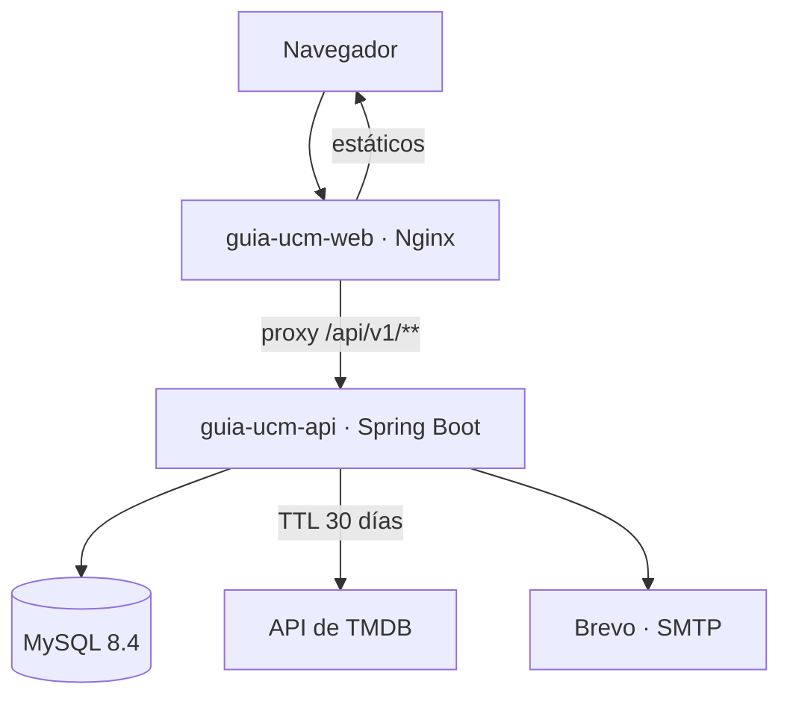
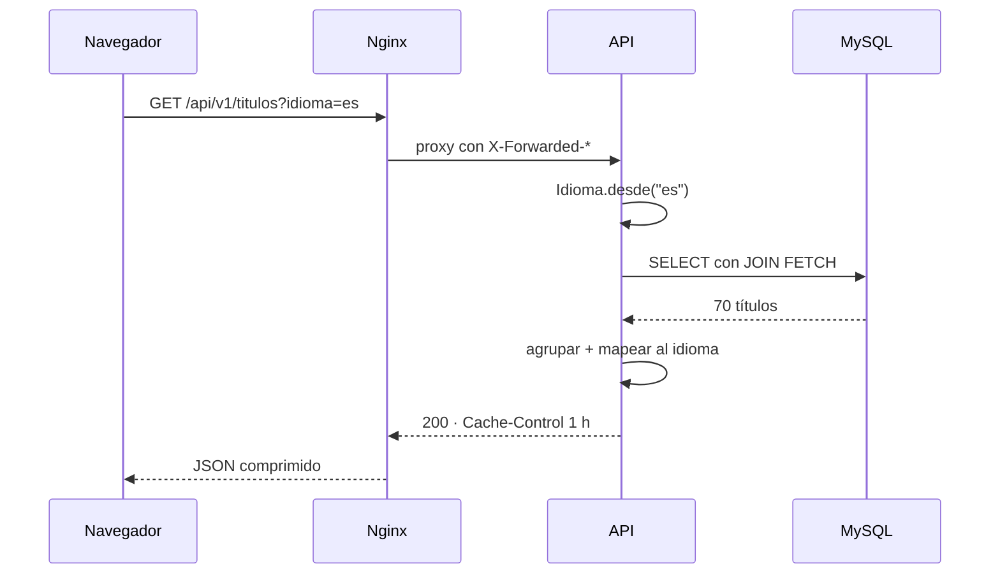

# 01 · Arquitectura

## Vista general



Dos contenedores y una base de datos que ya existía. Nada más.

## Por qué un monorepo

Frontend y backend cambian juntos: añadir un campo al catálogo toca la migración, la entidad, el
DTO y el componente que lo pinta. En un monorepo eso es **un solo commit** que la CI valida
entero, y el despliegue es un único `docker compose up`. Con dos repositorios habría que coordinar
versiones para cada cambio de contrato.

## Frontend

```
frontend/src/
├── app/          Raíz: proveedores, cabecera, pie
├── features/     Una carpeta por funcionalidad, no por tipo de archivo
│   ├── catalogo/ Guía, tarjetas, filtros, orden
│   └── progreso/ Tracker, estadísticas, maratón
├── components/ui Piezas reutilizables sin lógica de negocio
├── hooks/        Hooks transversales (tema)
├── services/     Cliente de la API, tipado
├── styles/       Tokens de diseño
├── tipos/        Tipos compartidos, calcados de los DTO
└── utils/        Texto y tiempo
```

La regla que ordena todo: **la lógica derivada vive en funciones puras**. `features/catalogo/
modelo.ts` sabe filtrar, agrupar y calcular estadísticas sin tocar React, y por eso se prueba con
Vitest en milisegundos. Los componentes solo deciden cómo se pinta.

### Estado

Tres tipos de estado, tres herramientas:

| Qué                          | Dónde                    | Por qué                                        |
| ---------------------------- | ------------------------ | ---------------------------------------------- |
| Catálogo (del servidor)      | TanStack Query           | Caché, reintentos y estados de carga gratis     |
| Progreso (de la persona)     | Zustand + `localStorage` | Sobrevive a recargar y se sincroniza en el hito 2 |
| Filtros (de la pantalla)     | `useState`               | Muere con la vista; no hace falta nada más      |

### Tema

Las variables CSS están en `styles/tokens.css`, agrupadas por nombre semántico (`--c-superficie`,
`--c-texto-suave`) y redefinidas bajo `[data-tema='oscuro']`. Ningún componente escribe un color
literal. Tailwind las consume con `@theme inline`, así que las utilidades cambian solas al
conmutar el tema.

El tema se aplica desde `public/tema.js` **antes** del primer pintado, para que quien entra con el
tema oscuro no reciba un fogonazo blanco. Va en un archivo aparte y no en línea porque la CSP usa
`script-src 'self'`.

## Backend

```
backend/src/main/java/dev/rubenlav/guiaucm/
├── config/    CORS, OpenAPI, propiedades
├── comun/     Idioma, excepciones y manejador global
└── catalogo/  Controller → Service → Repository + dominio y DTOs
```

Cada funcionalidad es un paquete con su vertical completa. Dentro, la cadena de siempre:
**Controller → Service → Repository**, con DTOs explícitos (nunca se expone una entidad) y
MapStruct para el mapeo.

### El catálogo se sirve entero

`GET /api/v1/titulos` devuelve las 70 filas de una vez, sin paginar. Es una excepción consciente a
la regla de paginar los listados: el tamaño es **fijo y no depende de quien llama**, así que no
hay superficie de abuso, y partirlo obligaría al cliente a encadenar peticiones para pintar la
primera pantalla. Los listados que sí crecen con los datos del usuario (progreso, valoraciones)
llevarán su tope.

Una sola consulta con `JOIN FETCH` trae títulos, bloques y sagas: nada de N+1.

### Idiomas

El catálogo guarda cada texto en las dos lenguas (`nombre_es` / `nombre_en`). El título en inglés
se deriva de la columna de búsqueda de TMDB, que es el título original, quitando el prefijo
«Marvel One-Shot: » de los cortos; solo se guarda explícito cuando esa regla no vale (temporadas
sueltas y la agrupación de los Defensores).

## Datos

Las claves que sostienen el modelo:

- **`titulos.id` es el orden cronológico.** Es la clave de negocio y a la que apuntan progreso,
  valoraciones, notas y la caché de TMDB.
- **`orden_estreno`** es la otra ordenación, con índice único: del 1 al 70, sin huecos.
- **`marcable`** distingue lo estrenado de lo que no. El denominador del progreso son los 67
  títulos marcables, no las 70 filas.
- **`cuenta_en_tiempo`** deja la Saga de los Defensores fuera de las estadísticas: son ≈140 h
  opcionales que convertirían cualquier estimación de maratón en un número irreal.
- **`agrupado`** marca las filas que no son un título sino un conjunto, y se pintan a lo ancho.

## Ciclo de vida de una petición



Si algo falla, el manejador global devuelve un `application/problem+json` con un mensaje genérico
y registra el detalle solo en el servidor.

## Enlaces

- [02 · API](02-api.md)
- [03 · Despliegue](03-despliegue.md)
- [04 · Seguridad](04-seguridad.md)
- [05 · Decisiones](05-decisiones.md)
